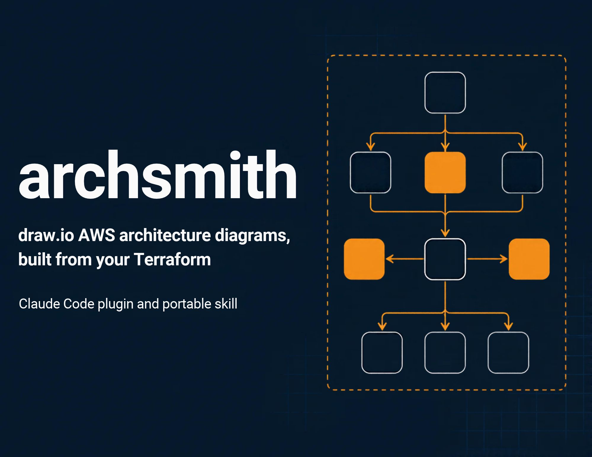

<p align="center">
  
</p>

<p align="center">
  <a href="https://github.com/nubeninja/archsmith/actions/workflows/ci.yml"></a>
  <a href="https://github.com/nubeninja/archsmith/actions/workflows/security.yml"></a>
  <a href="LICENSE"></a>
</p>

# archsmith

archsmith is a Claude Code plugin and a portable skill. It reads your repository's infrastructure code and builds draw.io diagrams of your AWS architecture and CI/CD pipelines, using the official AWS shapes.

It reads Terraform, CloudFormation, CDK, Helm values and workflow files, and it writes a `.drawio` file. Every label comes from your repository, not from a guess.

## What it makes

- **Overview tabs with layers:** network and services, EKS components, traffic flow, connectivity and security.
- **Slide tabs for presenting:** 1920x1080 pages with about 12 components each, large labels and one topic per tab.
- **Numbered badges and a legend** for diagrams with seven or more services.
- **Official shapes only** (`mxgraph.aws4.*`). No clip art and no image URLs.

## Quick start

Run these commands in Claude Code:

```
/plugin marketplace add nubeninja/archsmith
/plugin install archsmith@nubeninja
```

Then open the repository you want to draw and run:

```
/archsmith:setup
/archsmith:diagram
```

The setup asks two things: run as an inline **skill** or an isolated **agent**, and which folder gets the diagrams. Non-interactive form: `/archsmith:setup mode=skill dir=diagram`. It saves `.archsmith.json` in the repo root.

## How it works

<p align="center">
  
</p>

1. **Read your repo.** archsmith summarizes your Terraform first, so the model reads less, and then reads the files it needs.
2. **Build the diagram.** It generates overview tabs with layers and, by default, slide tabs.
3. **Check it.** A validator checks the XML, text size, label length, canvas size and likely overlaps.
4. **Review in draw.io.** Open the file, adjust it and share it.

## Run it as a skill or an agent

<p align="center">
  
</p>

`/archsmith:setup` asks which mode you want and where the diagrams should go. You can also pass the answers directly:

```
/archsmith:setup mode=skill dir=diagram slides=true
```

| Mode | Runs | Best for |
| --- | --- | --- |
| `skill` (default) | In your chat | Small repositories, refreshes and slides. It is cheaper, and you can steer it. |
| `agent` | In its own context | Large repositories and full rebuilds. It keeps your chat clean but uses more tokens in total. |

## Commands

| Command | What it does |
| --- | --- |
| `/archsmith:setup` | Choose skill or agent mode, the output folder, and whether to build slides |
| `/archsmith:diagram [what to draw]` | Build a new diagram from the repository's infrastructure code |
| `/archsmith:refresh [file.drawio]` | Update a diagram to match the code and keep the cells you added by hand |
| `/archsmith:slides [file.drawio] [topics]` | Add 1920x1080 slide tabs, one topic per tab |

You can also ask in plain words, for example: "Use archsmith to draw the architecture of this repository."

## Output

archsmith writes one `.drawio` file to `diagram/` (it creates the folder if needed) or to the path you give. It writes a PNG or JPEG only when you ask for one and give a size, for example "export a PNG that is 1600 px wide". Before it edits an existing file, it saves a backup named `<name>.drawio.bak`.

## Other AI tools (Codex, Cursor, others)

The skill in `skills/archsmith/` is a plain `SKILL.md` with `scripts/` and `references/`, with no Claude-only settings. Copy it into your tool's skills folder:

```
./install.sh codex      # or: claude, cursor, agents   (add --project for the current repo)
```

Or copy `skills/archsmith/` by hand. The scripts need Python 3 only. Slash commands and `/archsmith:setup` are Claude Code only.

The installer never overwrites an existing install unless you add `--force`. It has no dependencies and no install scripts. Releases are published from GitHub Actions with npm provenance, so you can verify a build with `npm audit signatures`.

- `drawio_lib.py`: builds pages, layers, groups, icons, edges, badges and a legend, and refuses duplicate ids.
- `validate.py`: checks XML, ids, edge ends, image URLs and shape libraries.
- `tf_summary.py`: summarizes Terraform (or `terraform show -json` output) so the model reads less.
- `preview_url.py`: prints a draw.io web link, so you can open the result with no desktop app.
- `render.sh`: exports PNG, JPEG, SVG or PDF with the draw.io desktop CLI.

## Requirements

- Python 3 for the scripts.
- Optional: the draw.io desktop CLI for rendering and export. macOS: install draw.io desktop. Linux or Windows: install from https://github.com/jgraph/drawio-desktop/releases and put `drawio` on PATH; headless Linux needs `xvfb-run`. Without it, archsmith still writes the file, checks the XML, and gives a web preview link.
- Optional: a draw.io MCP server, so the agent can look up shape names.

## Limits

- archsmith never deletes files without asking, and it never runs `git add`, `git commit` or `git push`.
- It draws what the repository defines. It does not read live AWS accounts.
- A model generates the layout. Open the file in draw.io and review it before you share it.

## Credits

The idea of the codebase-analysis and brainstorm modes, validation, numbered badges with a legend, and a no-install preview link comes from the AWS Labs [aws-architecture-diagram](https://github.com/awslabs/agent-plugins/tree/main/plugins/deploy-on-aws/skills/aws-architecture-diagram) skill (Apache-2.0). archsmith's code and text are written separately and copy none of it.

## License

Apache-2.0. See [LICENSE](LICENSE).
