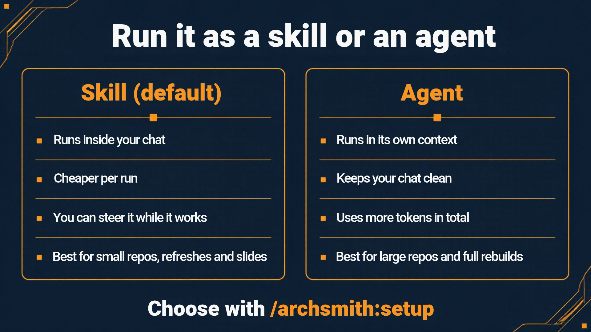

<p align="center">
  
</p>

<p align="center">
  <a href="https://github.com/nubeninja/archsmith/actions/workflows/ci.yml"></a>
  <a href="https://github.com/nubeninja/archsmith/actions/workflows/security.yml"></a>
  <a href="LICENSE"></a>
</p>

# archsmith

archsmith is a Claude Code plugin and a portable skill. It reads your repository's infrastructure code and builds draw.io diagrams of your AWS architecture and CI/CD pipelines, using the official AWS shapes.

It reads Terraform, CloudFormation, CDK, Helm values and workflow files, and it writes a `.drawio` file. Every label comes from your repository, not from a guess.

## What it makes

- **Overview tabs with layers:** network and services, EKS components, traffic flow, connectivity and security.
- **Slide tabs for presenting:** 1920x1080 pages with about 12 components each, large labels and one topic per tab.
- **Numbered badges and a legend** for diagrams with seven or more services.
- **Official shapes only** (`mxgraph.aws4.*`). No clip art and no image URLs.

## Quick start

Run these commands in Claude Code:

```
/plugin marketplace add nubeninja/archsmith
/plugin install archsmith@nubeninja
```

Then open the repository you want to draw and run:

```
/archsmith:setup
/archsmith:diagram
```

The result is a `.drawio` file in `diagram/`. Open it in [draw.io](https://www.drawio.com/) to review and edit it.

## How it works

<p align="center">
  
</p>

1. **Read your repo.** archsmith summarizes your Terraform first, so the model reads less, and then reads the files it needs.
2. **Build the diagram.** It generates overview tabs with layers and, by default, slide tabs.
3. **Check it.** A validator checks the XML, text size, label length, canvas size and likely overlaps.
4. **Review in draw.io.** Open the file, adjust it and share it.

## Run it as a skill or an agent

<p align="center">
  
</p>

`/archsmith:setup` asks which mode you want and where the diagrams should go. You can also pass the answers directly:

```
/archsmith:setup mode=skill dir=diagram slides=true
```

| Mode | Runs | Best for |
| --- | --- | --- |
| `skill` (default) | In your chat | Small repositories, refreshes and slides. It is cheaper, and you can steer it. |
| `agent` | In its own context | Large repositories and full rebuilds. It keeps your chat clean but uses more tokens in total. |

## Commands

| Command | What it does |
| --- | --- |
| `/archsmith:setup` | Choose skill or agent mode, the output folder, and whether to build slides |
| `/archsmith:diagram [what to draw]` | Build a new diagram from the repository's infrastructure code |
| `/archsmith:refresh [file.drawio]` | Update a diagram to match the code and keep the cells you added by hand |
| `/archsmith:slides [file.drawio] [topics]` | Add 1920x1080 slide tabs, one topic per tab |

You can also ask in plain words, for example: "Use archsmith to draw the architecture of this repository."

## Configuration

archsmith reads `.archsmith.json` from the repository root. The file is plain JSON. Commit it if your team wants shared settings, or add it to `.gitignore` if not.

```json
{ "mode": "skill", "outputDir": "diagram", "slides": true }
```

| Key | Default | Meaning |
| --- | --- | --- |
| `mode` | `skill` | `skill` runs inline and `agent` runs in its own context. Only the Claude Code commands use this key. |
| `outputDir` | `diagram` | The folder for new `.drawio` files when you do not give a path |
| `slides` | `true` | Also build 1920x1080 slide tabs. Use `false` for overview tabs only. |

## Output

archsmith writes one `.drawio` file to `diagram/` (it creates the folder if needed) or to the path you give. It writes a PNG or JPEG only when you ask for one and give a size, for example "export a PNG that is 1600 px wide". Before it edits an existing file, it saves a backup named `<name>.drawio.bak`.

## Use it in other AI tools

The skill in `skills/archsmith/` is a plain `SKILL.md` with `scripts/` and `references/` folders and no Claude-only settings, so it also works in Codex, Cursor and other tools that support skills. The slash commands and `/archsmith:setup` work only in Claude Code.

Copy the folder into your tool's skills folder by hand, or use the npm installer:

```
npx archsmith install                      # Claude Code, into ~/.claude/skills (default)
npx archsmith install codex                # or: claude, cursor, agents
npx archsmith install cursor --project     # the current repository instead of your home folder
```

> The npm package is published with the first tagged release. Until then, use the plugin install above or copy `skills/archsmith/` by hand.

The installer never overwrites an existing install unless you add `--force`. It has no dependencies and no install scripts. Releases are published from GitHub Actions with npm provenance, so you can verify a build with `npm audit signatures`.

## Scripts

These scripts live inside the skill:

- `drawio_lib.py` builds pages, layers, groups, icons, edges, badges and a legend, and it rejects duplicate ids.
- `validate.py` checks a diagram. See the next section.
- `tf_summary.py` summarizes Terraform (or the output of `terraform show -json`) so the model reads less.
- `preview_url.py` prints a draw.io web link, so you can open the result without the desktop app.
- `render.sh` exports PNG, JPEG, SVG or PDF with the draw.io desktop command line.

## Check a diagram yourself

archsmith runs the validator after every build. You can also run it on any `.drawio` file. It needs only Python 3.8 or newer and installs nothing:

```
python3 skills/archsmith/scripts/validate.py diagram/architecture.drawio
```

On Windows, use `python` or `py`. If you installed the plugin through Claude Code, the script lives inside the plugin folder. You can also ask archsmith to "validate this diagram" and it will run the script for you.

- **Errors** (exit code 1): invalid XML, compressed pages, duplicate ids, edges that point at nothing, and image URLs.
- **Warnings** (exit code 0): text under 20 px on slide pages or under 14 px on overview pages, labels longer than about nine words, an overview canvas larger than 3000 px, likely overlapping icons or labels, shape libraries other than AWS and GitHub, and a hardcoded background.
- `--strict` turns warnings into a failing exit code, which is useful in CI. `--min-font-slide N` and `--min-font-overview N` change the text-size limits.

The overlap check estimates label sizes from the text length, and it does not detect an arrow that crosses a label. Open the file in draw.io before you share it.

## Requirements

- Python 3.8 or newer for the scripts (standard library only).
- Optional: the draw.io desktop command line, for rendering and export.
  - macOS: install draw.io desktop.
  - Linux or Windows: download it from the [draw.io desktop releases](https://github.com/jgraph/drawio-desktop/releases) and put `drawio` on your `PATH`. Headless Linux also needs `xvfb-run`.
  - `render.sh` needs bash. On Windows, use Git Bash or WSL, or call the draw.io command line directly.
  - Without it, archsmith still writes the file, checks the XML and gives you a web preview link.
- Optional: a draw.io MCP server, so the agent can look up shape names.

## Limits

- archsmith never deletes files without asking, and it never runs `git add`, `git commit` or `git push`.
- It draws what the repository defines. It does not read live AWS accounts.
- A model generates the layout. Open the file in draw.io and review it before you share it.

## Security and releases

Read [SECURITY.md](SECURITY.md) to report a vulnerability. Read [docs/RELEASING.md](docs/RELEASING.md) to see how releases are built and published.


## License

Apache-2.0. See [LICENSE](LICENSE).
